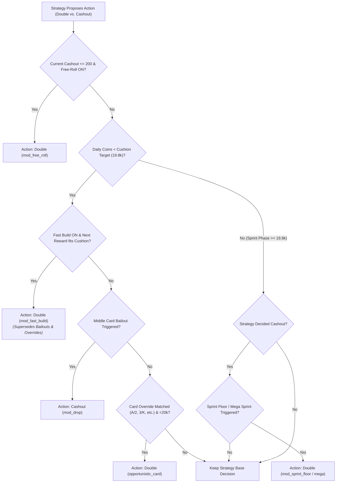

# Hololive Dreams Auto High & Low — Strategy Guide

## Game Rules

| Rule | Value |
|------|-------|
| **Double-up cap** | ~10,000 coins per round (game auto-settles) |
| **High-Low Ties** | Pushes (Re-Rolls) — drawing the same rank keeps the purse and lets you guess again |
| **Daily earning cap** | 20,000 coins (soft — can't start a new round once reached) |
| **Overshoot** | Allowed — final win is fully credited even if it exceeds 20k |
| **Unlimited plays** | No limit on rounds, only on daily total |

> **Optimal daily max:** ~32,600–33,900 coins — earn `19,800–19,900` in cushion cashouts, then max double-up (`12,800` or `14,000` on Five of a Kind) on the final round.

---

## Per-Hand Maximum Double-Up Payouts

The game only offers High-Low doubling while `current_cashout < 10,000` and automatically settles as soon as a payout reaches `>= 10,000`:

| Hand | Initial Payout | Doubling Progression (`< 10,000`) | Max Round Payout |
|:---|:---:|:---|:---:|
| **Two Pair / Three of a Kind** | `200` | `200 → 400 → 800 → 1,600 → 3,200 → 6,400 → 12,800` | **`12,800`** |
| **Straight** | `400` | `400 → 800 → 1,600 → 3,200 → 6,400 → 12,800` | **`12,800`** |
| **Flush** | `700` | `700 → 1,400 → 2,800 → 5,600 → 11,200` | **`11,200`** |
| **Full House** | `800` | `800 → 1,600 → 3,200 → 6,400 → 12,800` | **`12,800`** |
| **Four of a Kind** | `1,500` | `1,500 → 3,000 → 6,000 → 12,000` | **`12,000`** |
| **Straight Flush** | `3,000` | `3,000 → 6,000 → 12,000` | **`12,000`** |
| **Five of a Kind** | `7,000` | `7,000 → 14,000` | **`14,000`** |
| **Royal Flush** | `10,000` | `10,000 → 20,000` | **`20,000`** |

---

## Operational Modes

The bot provides two distinct operational modes controlled via a 2-column action bar:

| Mode | Trigger | Control | Behavior |
|:---|:---:|:---:|:---|
| **Auto Bot** | `▶ START BOT` button | Clicks enabled | Fully autonomous gameplay: evaluates initial hands with Numba combinatorial poker solver, corrects hold selections, tracks cards in real time, and executes High-Low doubling according to the chosen strategy. |
| **Observer Mode** | `👁 OBSERVER MODE` or `F9` | Zero clicks | Manual play assistant: tracks revealed cards, calculates remaining deck odds, and logs optimal hold combinations and doubling decisions to guide human play without sending any mouse inputs. |

- **Hotkeys**:
  - `Stop Hotkey` (default `INSERT`): Instantly commands the active session (Auto Bot or Observer Mode) to wait for current screen animations and safely exit.
  - `Observer Hotkey` (default `F9`): When idle, starts Observer Mode. When already running, seamlessly toggles live between Auto Bot (clicks enabled) and Observer Mode (clicks disabled).
- **Tooltips**: Hovering over either mode button in the UI surfaces full functional descriptions and current hotkey shortcuts.

---

## Strategy Play Style (`Aggressive` / `Default` / `Conservative`)

Located directly above the **Strategy Modifiers** drawer on both the **Auto Bot** and **Simulation** tabs, the **Strategy Play Style** section provides 3 mutually-exclusive toggles (`Default` is active by default and saved automatically):

| Play Style | Effect on Strategies |
|:---|:---|
| **Aggressive** | Lowers win-rate floors by ~5% and pushes earlier into high-payout phases (e.g., turns `Balanced` into the **Aggressive Balanced** profile: 50%/45% win-rate floors, 12k push threshold, +30.3k net profit). |
| **Default** *(Default ON)* | Uses each strategy's standard mathematically calibrated win-rate floors, cashout targets, and downshift triggers. |
| **Conservative** | Raises win-rate floors by ~5% and banks smaller, safer cashouts earlier (e.g., `Balanced` cashes out at 3,200+ in build phase with 60%/55% win-rate floors). |

---

## Available Strategies (7 Policies)

### 1. Balanced (`balanced`) — *Recommended Default Strategy*

Delivers the highest actual net wallet profit (**~30,200–30,300 Net Coins**, ~32.4k Gross) in ~13–19 minutes with low ticket burn (~31 rounds). Adapts across all 3 **Strategy Play Styles**:

- **Default Style**:
  - **Build** (`daily < 15,000`): Cashout at `6,400+`, win rate floor `55%`
  - **Push** (`15k ≤ daily < 19,800`): Higher threshold, win rate floor `50%`, dynamic `19,800–19,900` cushion guard
  - **Sprint** (`daily ≥ 19,800`): Max double-up for `10,000+`
- **Aggressive Style** *(formerly `Aggressive Balanced`)*:
  - **Build** (`daily < 12,000`): Cashout at `6,400+`, win rate floor `50%`
  - **Push** (`12k ≤ daily < 19,800`): Let rounds ride, win rate floor `45%`, dynamic `19,800–19,900` cushion guard
  - **Sprint** (`daily ≥ 19,800`): Max double-up for `10,000+`
- **Conservative Style**:
  - **Build** (`daily < 16,000`): Cashout at `3,200+`, win rate floor `60%`
  - **Push** (`16k ≤ daily < 19,800`): Cashout at `6,400+`, win rate floor `55%`, dynamic `19,800–19,900` cushion guard
  - **Sprint** (`daily ≥ 19,800`): Max double-up for `10,000+`

**Expected:** ~32.4k Gross (+30.2k–30.3k Net) | **Risk:** Moderate | **Time:** Medium (~13–19 min)

---

### 2. Adaptive Max Profit (`max_profit`)

Maximizes daily profit to **~32,600–33,700 coins** dynamically:

- **Dynamic Even/Odd Cushion** (`daily < 19,800`, banking ceiling `<= 19,900`):
  - Even-hundred totals bank up to **19,800** (`19,600 + 200 = 19,800`), while odd-hundred totals (from `700` Flush or `1,500` Four of a Kind) bank up to **19,900** (`19,700 + 200 = 19,900`, `19,200 + 700 = 19,900`, `14,300 + 5,600 = 19,900`, `18,400 + 1,500 = 19,900`).
  - Win rate floor adjusts with Play Style (`55%` Aggressive / `60%` Default / `65%` Conservative).
  - **Early Overshoot Safety**: If a hand would overshoot `19,900` before reaching the `19,800` cushion:
    - If `daily_coins + max_round_payout >= 32,600` (e.g., `19,600 + 14,000 = 33,600` or `19,700 + 14,000 = 33,700` on Five of a Kind), the bot plays to win the early max payout.
    - Otherwise (`daily_coins + max_round_payout < 32,600`), the bot enters High-Low and **intentionally picks the lower-probability choice** (`intent_to_fail`) to cancel the hand and protect the `19,800–19,900` cushion.
- **Sprint** (`daily ≥ 19,800`): Chases `10,000+` cashout (`11,200–14,000`), ignoring win rate.

**Expected:** ~29k–33.7k | **Risk:** Medium-High | **Time:** Medium-Long

---

### 3. Fastest Clear (`fastest_clear`)

Reach 20,000+ coins as fast as possible. All-or-nothing:

- Every round goes for max double-up (game auto-settles at ~10k cap)
- Only cashout if doing so reaches the daily cap (or at `6,400+` when `Conservative` play style is active and win rate `< 50%`)
- Stop when daily ≥ 20,000

**Expected:** ~20k-25k | **Risk:** Highest | **Time:** Fastest (~8 min)

---

### 4. Adaptive Rush (`adaptive_rush`)

Starts aggressive, auto-downshifts if failing too much:

- **Rush mode (default):** Max double-up every round (like Fastest)
- **Auto-adjust triggers:** `10+` consecutive fails OR net profit `< -2,000` (`15 / -3,000` on Aggressive; `6 / -1,000` on Conservative)
- **Cushion mode (fallback):** Small cashouts (`3,200+` Default, `6,400+` Aggressive, `1,600+` Conservative), win rate floor `55%` (`50%` Aggressive / `60%` Conservative), dynamic `19,800–19,900` cushion guard
- **Sprint** (`daily ≥ 19,800`): Max double-up for `10,000+`

Once in cushion mode, stays there (no switching back).

**Expected:** ~25k-32k | **Risk:** Self-adjusting | **Time:** Adaptive

---

### 5. Grinder (`grinder`)

Ultra-safe, minimum risk:

- **Build** (`daily < 19,800`): Cashout at `1,600+` (`3,200+` Aggressive / `800+` Conservative), max `4` doubles per round (`5` Aggressive / `3` Conservative), win rate floor `60%` (`55%` Aggressive / `65%` Conservative), dynamic `19,800–19,900` cushion guard
- **Sprint** (`daily ≥ 19,800`): One final max double-up attempt

**Expected:** ~28k-32k | **Risk:** Lowest | **Time:** Longest

---

### 6. Custom Parametric (`custom_parametric`)

Fully user-configurable strategy. Set your own parameters via the GUI:

| Parameter | Config Key | GUI Default | Description |
|-----------|-----------|-------------|-------------|
| Cushion Target | `param_cushion_target` | 19,800 | Target cap room before switching to sprint |
| Min Win Rate | `param_min_win_rate` | 60 (%) | Minimum win rate before forced cashout |
| Sprint Target | `param_sprint_target` | 10,000 | Min cashout to accept during sprint |
| Max Doubles | `param_max_doubles` | 10 | Max doubles per round |
| Max 14k Hunt Attempts | `hunt_14k_attempts` | 0 (Unlimited) | Max Five of a Kind sprint attempts before Adaptive fallback |
| Drop on 7/8 | `param_drop_seven_eight` | false | Always cashout when facing a 7 or 8 |

**Expected:** Varies | **Risk:** User-defined | **Time:** Varies

---

### 7. True Max Coins (33.9k Trophy Hunt) (`true_max_coins`, alias: `true_max_profit`)

Targets the absolute theoretical maximum of **33,900 coins (`19,900 + 14,000`)**:

> [!WARNING]
> **High Ticket Cost / Negative Net Profit**:
> Chasing Five of a Kind in a 53-card deck requires an average of 1,300–2,700 rounds, burning 65,000–135,000+ coins in 50-coin entry tickets. Resulting net wallet profit is **negative (-30k to -100k+)**. Use this mode strictly for trophy screenshots and max gross daily coin count.

- **Parity-Aware Cushion to 19,900** (`daily < 19,900`):
  - When `daily_coins` is an even hundred (`daily_coins % 200 == 0`), immediately locks in any un-doubled **Flush (`700`)** or **Four of a Kind (`1,500`)** to flip `daily_coins` to an odd hundred, and caps even-hundred totals at `<= 19,200` to leave exact headroom for a `700` Flush (`19,200 + 700 = 19,900`).
  - Once `daily_coins` is an odd hundred, normal `200 / 400 / 800` hands step directly to **19,900**.
- **Five of a Kind Sprint** (`daily == 19,900`):
  - Only accepts **Five of a Kind (`7,000 → 14,000`)** in the final sprint (`19,900 + 14,000 = 33,900`).
  - Any lower hand (`200–3,000`, max `11,200–12,800`) is **purposely failed** in High-Low so the bot can keep drawing for Five of a Kind.
  - Configurable **Max 14k Hunt Attempts (`hunt_14k_attempts`)** via the `⚙️ Config` button (`0` = unlimited) and supports live fallback via the **`⚡ Intercept: Adaptive`** button on the Auto Bot tab.

**Expected:** 33,900 (or ~32.7k on fallback) | **Net Profit:** -30k to -100k+ | **Risk:** Extreme Ticket Burn | **Time:** Hours / Overnight

---

## Strategy Modifiers & Collapsible Drawer

In addition to each strategy's built-in decision tree, the bot provides a collapsible **Strategy Modifiers** drawer directly on both the **Auto Bot** and **Simulation** tabs in the main UI, featuring modern anti-aliased rounded pill toggle switches with concise labels.

The drawer includes a one-click **`↺ Reset`** button to restore default recommendations at any time, and is divided into three distinct collapsible categories (`▼` / `▶` toggle on header click):

### 1. Progression & Sprint Phase (Collapsible)
- **Fast Build (`mod_fast_build`)**: Forces maximum doubling throughout the cushion phase ($< 19,800$) as long as the next payout fits within 19,900, rapidly accelerating bankroll accumulation from Two Pair hands.
- **Free-Roll (`mod_free_roll`)**: Forces doubling on round payouts of 200 or less (initial Two Pair qualifying payout) regardless of the card drawn, turning minimal payouts into high-value opportunities with zero downside.
- **Force 19,900 Cushion (`mod_force_19900`)**: Uses parity-aware doubling and intentional fail guards to align bankroll specifically on `19,900` before entering the Sprint phase (rather than stopping at `19,800`).
- **Sprint Floor 11.2k+ (`mod_sprint_floor`)**: During the sprint phase ($\ge 19,800$), refuses cashouts under 11,200 and forces doubling (or intentionally fails sub-11.2k hands) to guarantee a total daily finish of at least 31,000+ coins.
- **Mega Sprint 12.8k+ (`mod_mega_sprint`)**: During the sprint phase ($\ge 19,800$), refuses cashouts under 12,800 and forces doubling (or intentionally fails sub-12.8k hands) to target a 32,600+ daily finish (mutually exclusive with Sprint Floor).
- **Hunt 14k (Five of a Kind) (`mod_hunt_14k`)**: During the sprint phase, intentionally fails any hand that cannot reach a 14,000 max payout (only Five of a Kind `7,000 * 2 = 14,000` is accepted; Flush `700 -> 11,200` or Two Pair `200 -> 12,800` are rejected) up to the configured `hunt_14k_attempts` limit (default `0` = unlimited). When attempts are exhausted or cancelled live via the **`⚡ Intercept: Adaptive`** button on the Auto Bot tab, it falls back to Adaptive sprint.

### 2. Defensive Bailouts (Collapsible, Under 19.8k Cushion)
Provides immediate cashout protection on volatile middle cards during the cushion phase, avoiding 50/50 wipes:
- **Bail on 8 only (`mod_drop_8`)**: Cashes out only when dealt card 8 (exact 50.0% coin-flip odds with zero edge), while allowing 7 and 9 to continue.
- **Bail on 7 & 8 (`mod_drop_78`)**: Cashes out whenever dealt 7 or 8 to avoid coin-flip trap cards.
- **Bail on 6/7/8/9 (`mod_drop_6789`)**: Ultra-safe grinding policy that cashes out on any middle card (6 through 9; $\le 66.7\%$ win rate).

### 3. Card Overrides (Collapsible, Double Under Cap)
Whenever the active strategy proposes a **Cashout**, the bot inspects the visible base card before accepting payout. If the card matches an enabled override and post-double coins remain strictly under the daily cap ($\le 19,900$), the bot **overrides the cashout** to continue doubling:

| Override Tier | Target Cards | 52-Card Win Odds (Ties Push) | Risk Rating |
|:---|:---|:---:|:---:|
| **A & 2** *(Default ON)* | Ace (14) & 2 | **100.0%** (48 / 48) | Deterministic Win |
| **3 & K** *(Default ON)* | 3 & King (13) | **91.7%** (44 / 48) | Highly Favorable |
| **4 & Q** *(Default ON)* | 4 & Queen (12) | **83.3%** (40 / 48) | Favorable |
| **5 & J** | 5 & Jack (11) | **75.0%** (36 / 48) | Aggressive Build |
| **6 & 10** | 6 & 10 | **66.7%** (32 / 48) | Moderate Risk |
| **7 & 9** | 7 & 9 | **58.3%** (28 / 48) | Near Coin-Flip |
| **8** | 8 | **50.0%** (24 / 48) | Pure 50/50 Coin Flip |

#### Strict Lockout Prevention Guard
$$\text{daily\_coins} + \text{next\_reward} \le \min(\text{target\_limit} - 100,\; \text{cushion} + 100)$$
- With the default 20,000 target limit, the maximum post-double payout allowed under an override is **19,900** (or **19,800** for even-hundred progression when `Force 19,900` is off).
- Landing on or over 20,000 on the dot (e.g. `18,400 + 1,600 = 20,000`) is strictly **disallowed**. This guarantees the bot never locks itself out of starting the final round, preserving the opportunity to sprint for a 10,000+ overflow payout.

### 4. UI Mutual Exclusion, Quick Reset & Live Intercept
To eliminate conflicting automated decisions, the UI enforces automatic mutual exclusion and real-time operator feedback:
- **Fast Build > Overrides & Bailouts**: Enabling *Fast Build* forces doubling on all cards under cushion (19,800–19,900), automatically greying out and superseding all Card Overrides and Defensive Bailouts.
- **Defensive Bailouts > Overrides**: Enabling *Bail 6/7/8/9* automatically unchecks and disables *6/10*, *7/9*, and *8*; enabling *Bail 7/8* disables *7/9* and *8*; enabling *Bail 8* disables *8*.
- **Overrides > Bailouts**: Enabling a middle-card override (*8*, *7/9*, or *6/10*) automatically unchecks contradictory bailouts.
- **Sprint Floors**: Enabling *Mega Sprint* automatically unchecks *Sprint Floor*, and vice versa.
- **Modifiers Reset (`↺ Reset`)**: A dedicated reset button situated next to the expand/collapse drawer toggle instantly resets all modifier toggles and card overrides back to factory defaults.
- **Live Mid-Game Log Feedback**: Modifying Strategy Play Style, flipping modifier/override toggles, or clicking Reset outputs immediate localized feedback directly into the UI log view and session log file without interrupting active play.
- **Live `⚡ Intercept: Adaptive` Button**: Available on the Auto Bot tab whenever `Max Profit (Can Take a Long Time)` or `Hunt 14k` is active. Clicking it arms an immediate fallback to Adaptive Sprint so the bot finishes on the very next high-value sprint hand without losing session progress.

---

## Quick Comparison

### Category A: Maximum Net Profit (Recommended for Wallet Coins)
| Strategy | Play Style | Gross Coins | Net Profit | Risk | Avg Time | Best For |
|----------|-----------|------------|------------|------|----------|----------|
| **Balanced** *(Default)* | `Default` / `Aggressive` | ~32.4k | **~30.2k–30.3k Net** | Moderate | ~13 min | **Best default strategy & highest net profit** |
| **Adaptive Max Profit** | `Default` | ~32.4k | **~29.7k Net** | Med-High | ~15 min | Aggressive 10k+ final sprint with any hand |

### Category B: Speed & Stability Grinding
| Strategy | Gross Coins | Net Profit | Risk | Avg Time | Best For |
|----------|------------|------------|------|----------|----------|
| **Fastest Clear** | ~25.0k | **~23.8k Net** | Highest | **~8 min** | Speed runs (fewest rounds) |
| **Adaptive Rush** | ~28.8k | **~27.2k Net** | Adaptive | ~10 min | Fast with auto-downshift safety |
| **Grinder** | ~32.4k | **~28.9k Net** | Lowest | ~20 min | Ultra-safe, capped doubles |

### Category C: Specialized & Trophy
| Strategy | Gross Coins | Net Profit | Risk | Avg Time | Best For |
|----------|------------|------------|------|----------|----------|
| **Custom Parametric** | Varies | Varies | Custom | Varies | User-tuned parameters |
| ⚠️ **True Max Coins** | 33,900 | **-30k to -100k+** | Extreme | Hours | 33.9k trophy screenshot (high ticket cost) |

